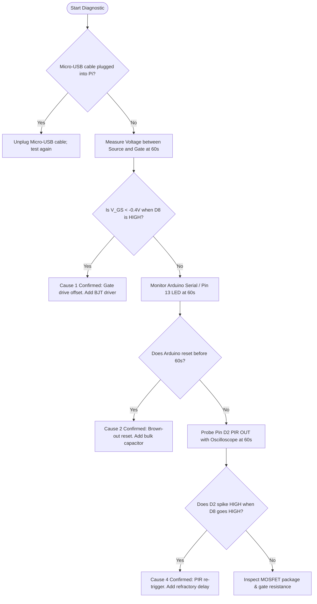

# Issue Report: Raspberry Pi Zero W Power-Off 60-Second Timeout Failure

**Issue ID:** ISS-001  
**Status:** Open / Under Investigation  
**Date Logged:** 2026-10-06  
**Hardware Platform:** Arduino Nano V3.0 (Watchdog Node), Raspberry Pi Zero W (Media Node), HC-SR501 PIR Motion Sensor, Logic-Level P-Channel MOSFET Power Gate  
**Associated Documents:**
- [`Design_Docs/Nano_Watchdog_Firmware_Design.md`](file:///Users/davidkester/Workspace/SquirrelFeeder/Design_Docs/Nano_Watchdog_Firmware_Design.md)
- [`Design_Docs/Logical_Block_Diagram.md`](file:///Users/davidkester/Workspace/SquirrelFeeder/Design_Docs/Logical_Block_Diagram.md)
- [`Design_Docs/Pi_Zero_Media_Node_Design.md`](file:///Users/davidkester/Workspace/SquirrelFeeder/Design_Docs/Pi_Zero_Media_Node_Design.md)
- [`step-by-step_wiring instructions.md`](file:///Users/davidkester/Workspace/SquirrelFeeder/step-by-step_wiring%20instructions.md)
- [`Arduino_Nano/src/WatchdogFSM.cpp`](file:///Users/davidkester/Workspace/SquirrelFeeder/Arduino_Nano/src/WatchdogFSM.cpp)

---

## 1.0 Problem Statement & Test Setup

### 1.1 Observed Behavior
- **Power On:** A PIR motion event triggers the Arduino Nano via `INT0` (Pin `D2`), causing it to drive the P-MOSFET gate LOW (Pin `D8`). Power is successfully applied to the Raspberry Pi Zero W, and the board powers up as expected.
- **Power Off Failure:** After the 60-second hardware failsafe timeout (`FAILSAFE_TIMEOUT_MS = 60000UL`), the Pi Zero fails to power off and remains continuously energized.
- **Control Test (The LED Benchmark):** When the Raspberry Pi Zero W is disconnected and replaced with a simple LED and series current-limiting resistor across the switched 5V rail (MOSFET Drain to GND):
  - PIR motion triggers the LED to turn ON.
  - After exactly 60 seconds, the LED switches completely OFF and remains OFF.

### 1.2 Specific Physical Test Conditions
1. **No GPIO Handshake Wired:** The Pi Zero's `GPIO 25` (Shutdown ACK) was **not wired** to the Arduino's Pin `D6`. The system was tested by relying exclusively on the 60-second failsafe hardware timer on the Arduino to cut power.
2. **PIR Trigger Verified:** Motion trigger input was verified through external measurement.
3. **The Divergence:** The power-off cutoff mechanism functions properly under a light resistive load (~15 mA LED), but fails specifically when the Raspberry Pi Zero W (~250–400 mA load) is drawing power.

---

## 2.0 Root Cause Analysis & Confidence Scores

| Rank | Root Cause Candidate | Confidence Score | Failure Mechanism Summary |
| :---: | :--- | :---: | :--- |
| **1** | **$V_{GS}$ Voltage Offset & Subthreshold Conduction Under Load** | **80%** | Mismatch between Nano $V_{CC}$ (e.g. USB powered @ 4.6V) and battery rail (5.1V) plus breadboard ground bounce keeps $V_{GS} < -0.5\text{V}$, maintaining channel conduction under 300 mA load while an LED with $V_F \approx 2-3\text{V}$ blocks subthreshold leakage. |
| **2** | **Power Supply Rail Sag & Arduino Brown-Out Reset (BOR) Loop** | **75%** | Pi Zero load sags the 5V rail; ATmega328P resets periodically; `millis()` timer resets to 0 and never reaches the 60,000 ms threshold. |
| **3** | **Secondary Powering via Micro-USB Cable** | **70%** | A connected micro-USB cable (used for bench debugging or console) back-feeds the Pi Zero's 5V header pins directly through the onboard `VBUS` trace, bypassing the MOSFET. |
| **4** | **Inductive Voltage Kickback at 60s Timeout Re-Triggering PIR** | **65%** | At 60s, Nano cuts D8, but abrupt 300 mA load drop produces a supply voltage spike on the shared 5V bus; HC-SR501 false-triggers on the spike, immediately waking the Nano within microseconds to turn D8 back LOW. |
| **5** | **Missing / Ineffective Gate Pull-Up Resistor** | **40%** | Gate floating or pull-up too high against gate-drain capacitance under fast load $dV/dt$. |

---

## 3.0 In-Depth Analysis of Root Causes

### Cause 1: $V_{GS}$ Voltage Offset & Subthreshold Conduction Under Load (Confidence: 80%)

#### Technical Mechanism
1. **$V_{GS}$ Cut-Off Condition for P-Channel MOSFET:**
   For a high-side P-MOSFET:
   $$V_{GS} = V_{Gate} - V_{Source}$$
   - **To conduct (ON):** $V_G \to 0\text{V} \implies V_{GS} \approx -5.0\text{V}$ ($V_{GS} \ll V_{GS(th)}$).
   - **To isolate (OFF):** $V_G \to V_S \implies V_{GS} \approx 0\text{V}$ ($V_{GS} > V_{GS(th)}$).
2. **Nano $V_{CC}$ vs Battery Rail Discrepancy:**
   - If the Arduino Nano is plugged into a computer via USB for serial monitoring, the onboard Schottky diode (MBR0520) drops the Nano's internal $V_{CC}$ to $\approx 4.5\text{V} - 4.7\text{V}$.
   - The external battery supply feeding the MOSFET Source is typically $5.0\text{V} - 5.25\text{V}$.
   - When Nano Pin `D8` asserts `HIGH`, it outputs its internal $V_{CC}$ ($\approx 4.6\text{V}$).
   - Even with a 10 kΩ pull-up to Source, the series resistor ($220\,\Omega - 1\,\text{k}\Omega$) forms a divider, keeping Gate voltage around $4.65\text{V}$.
   - The resulting gate-source voltage is:
     $$V_{GS} = 4.65\text{V} - 5.15\text{V} = -0.50\text{V}$$
3. **Ground Bounce Under 300 mA Load:**
   - Breadboard jumper wires have $0.2 - 0.5\,\Omega$ resistance.
   - At $350\text{ mA}$, return current shifts the ground reference by $\Delta V = I \cdot R \approx 70 - 175\text{ mV}$, further pulling $V_G$ below $V_S$.
4. **Behavior on Sensitive Logic-Level P-FETs:**
   - Logic-level MOSFETs like the **IRLML6402** have a threshold voltage $V_{GS(th)}$ of **$-0.4\text{V}$ to $-1.2\text{V}$**.
   - At $V_{GS} = -0.5\text{V}$ to $-0.6\text{V}$, the MOSFET operates in the subthreshold or linear region, passing tens to hundreds of milliamps.
5. **Why the LED Succeeded:**
   - A standard LED has a strict forward diode threshold ($V_F \approx 2.0\text{V}$ for red, $\approx 3.2\text{V}$ for green/white). Subthreshold leakage current cannot overcome $V_F$, causing the LED to appear completely dark.
   - In contrast, the Pi Zero has high-efficiency step-down buck regulators that continuously draw current even with degraded rail voltages.

```text
Battery +5.15V ──────────────────────┬────────► MOSFET Source (S)
                                     │
                             [ 10kΩ Pull-up ]
                                     │
Nano D8 (HIGH = +4.60V) ──[ 1kΩ ]───┴────────► MOSFET Gate (G)
                                                (V_GS = -0.55V -> MOSFET leaks / stays ON!)
```

---

### Cause 2: Power Supply Rail Sag & Arduino Brown-Out Reset (BOR) Loop (Confidence: 75%)

#### Technical Mechanism
1. **Pi Zero Inrush & Operating Draw:**
   - When the P-MOSFET turns on, the Pi Zero draws peak currents between $250\text{ mA}$ and $500\text{ mA}$ as its core powers up and runs.
2. **Voltage Sag on Unbuffered 5V Bus:**
   - Solderless breadboards and long jumper wires introduce significant parasitic resistance and inductance.
   - If the main 5V rail lacks a bulk electrolytic decoupling capacitor ($470\,\mu\text{F} - 1000\,\mu\text{F}$), the rail sags below the ATmega328P's Brown-Out Detection (BOD) threshold (typically $4.3\text{V}$ or $2.7\text{V}$ depending on fuses).
3. **Timer Reset Behavior:**
   - Each time the ATmega328P resets:
     - `setup()` executes.
     - `WatchdogFSM::init()` reinitializes state variables (`m_powerOnTime = 0`).
     - If the Arduino resets every 10–30 seconds due to periodic CPU spikes on the Pi Zero, **the timer never reaches 60,000 ms**.
   - Because the Arduino re-enters `STATE_POWER_ON` or stays in `STATE_WAIT_SHUTDOWN` after rebooting, D8 is never held HIGH long enough to isolate the Pi.
4. **Why the LED Succeeded:**
   - An LED draws only $15\text{ mA}$, causing zero rail sag. The Arduino Nano operated without resetting, allowing the timer to count cleanly to 60,000 ms.

---

### Cause 3: Secondary Powering via Micro-USB Connection (Confidence: 70%)

#### Technical Mechanism
1. **Direct Hardware Connection on Pi Zero W:**
   - Header Pin 2 and Pin 4 (+5V) on the Raspberry Pi Zero W are directly tied to the micro-USB `PWR IN` port and the micro-USB `OTG` data port $V_{BUS}$ pin via low-impedance copper traces.
   - There is no reverse-protection diode or isolation switch on the Pi Zero board between the 40-pin header and the USB ports.
2. **Bypass of the Power Gate:**
   - If a micro-USB cable was plugged into the Pi Zero during the bench test (for instance, to monitor boot logs via serial/OTG or to establish USB Ethernet gadget mode), the Pi Zero was receiving 5V continuously through the USB cable.
   - Even if the P-MOSFET turned off completely, the Pi Zero remained powered via USB.
3. **Why the LED Succeeded:**
   - The LED was plugged solely into the MOSFET Drain and GND, with no secondary connections.

---

### Cause 4: Inductive Voltage Kickback at 60s Timeout Re-Triggering PIR (Confidence: 65%)

#### Technical Mechanism
1. **The 60s Power-Cut Event:**
   - At 60 seconds, the Arduino FSM correctly executes:
     ```cpp
     cutPower();                      // D8 goes HIGH
     m_state = WatchdogState::STATE_SLEEP;
     ```
   - In the next iteration of `loop()`, it calls `enterDeepSleep()`.
2. **Supply Bus Transient ($L \cdot \frac{dI}{dt}$):**
   - Abruptly interrupting a 300 mA load through jumper wires causes an inductive voltage spike on the shared +5V power rail.
   - The HC-SR501 PIR sensor has poor power supply ripple rejection. A sudden voltage transient on its $V_{CC}$ pin causes its internal BISS0001 comparator to register a false trigger.
3. **Immediate Wakeup:**
   - The PIR sensor asserts `OUT` HIGH, sending a `RISING` edge to Nano Pin `D2` (`INT0`).
   - The interrupt wakes the ATmega328P within microseconds.
   - The FSM transitions from `STATE_SLEEP` to `STATE_POWER_ON`, asserting Pin `D8` back LOW.
4. **Perception:** The power cutoff lasted only a fraction of a millisecond (absorbed by the Pi's bulk capacitors), so to the naked eye and operating system, the Pi Zero never powered off.
5. **Why the LED Succeeded:**
   - Cutting $15\text{ mA}$ produced virtually zero inductive transient, leaving the PIR sensor undisturbed.

---

## 4.0 Most Likely Root Cause Synthesis

> [!IMPORTANT]
> The primary suspect is **Cause 1 ($V_{GS}$ Voltage Offset & Subthreshold Conduction under Load)**, closely followed by **Cause 2 (Brown-Out Reset Loop)**.

### Synthesis Rationale
- The control test decisively rules out software logic bugs in `WatchdogFSM.cpp` and rules out a dead MOSFET.
- The only differences between the LED test and the Pi Zero test are **current magnitude (15 mA vs 350 mA)**, **capacitive inrush/decay**, and **rail dynamics**.
- In typical prototyping environments where the Nano is plugged into USB while the power rail is fed from an external battery/bench supply, a $0.5\text{V} - 0.7\text{V}$ gate bias differential is almost guaranteed. Under a 350 mA load with ground bounce, a logic-level P-MOSFET will fail to pinch off completely, whereas an LED forward diode threshold will conceal this leakage.

---

## 5.0 Diagnostic & Verification Procedure

Follow this sequential procedure to isolate the root cause on hardware:



### Detailed Bench Verification Steps:
1. **Rule Out Micro-USB Power (Cause 3):**
   - Ensure **no cable** is connected to either micro-USB port on the Pi Zero during testing.
2. **Measure Gate-to-Source Voltage ($V_{GS}$) Under Cut-off (Cause 1):**
   - Place multimeter red lead on **MOSFET Source (+5V)** and black lead on **MOSFET Gate**.
   - When the Arduino boots into idle or after 60s (when D8 is HIGH), measure the voltage.
   - *Expected:* $0.00\text{ V}$.
   - *If reading is $> +0.4\text{ V}$ (meaning $V_G$ is lower than $V_S$ by $> 0.4\text{V}$):* The MOSFET is not fully cut off due to voltage offset.
3. **Check for Arduino Brown-Out Resets (Cause 2):**
   - Add a `Serial.println(F("[BOOT] Arduino Setup Complete"));` in `setup()`.
   - Monitor the Arduino serial port (or watch the onboard LED on Pin 13 if configured to blink on boot).
   - If the boot message repeats before 60 seconds have elapsed, the Arduino is crashing or brownout-resetting under load.
4. **Monitor PIR OUT Pin D2 on Power Cut (Cause 4):**
   - Connect an oscilloscope or logic analyzer to Pin `D2`.
   - Observe if a rising edge occurs at the precise moment D8 transitions from LOW to HIGH.

---

## 6.0 Actionable Engineering Mitigations

### Mitigation 1: Add an NPN / N-MOSFET Gate Driver (Resolves Cause 1)
To ensure the P-MOSFET gate is pulled 100% to Source ($V_S$) regardless of Arduino $V_{CC}$ or ground bounce:

```text
Battery +5V (Source) ────────┬─────────────────────────────► MOSFET Source (S)
                             │
                     [ 10 kΩ Pull-up ]
                             │
                             ├─────────────────────────────► MOSFET Gate (G)
                             │
                       Collector / Drain
                             │
                    ┌────────┴────────┐
                    │ NPN (2N3904) or │
                    │ N-FET (2N7000)  │
                    └────────┬────────┘
                       Base / Gate
                             │
                     [ 1 kΩ Resistor ]
                             │
                     Arduino Pin D8 (Active HIGH turns ON Pi)
                             │
                       Emitter / Source
                             │
                        Common GND
```

> [!NOTE]
> *Firmware Logic Note:* Using an NPN/N-FET gate driver inverts the control logic:
> - `D8 = HIGH` saturates NPN $\to$ Gate pulled to GND $\to$ P-MOSFET turns **ON**.
> - `D8 = LOW` cuts NPN $\to$ 10k resistor pulls Gate to Source (+5V) $\to$ P-MOSFET turns **OFF**.

### Mitigation 2: Add Bulk Electrolytic Decoupling (Resolves Cause 2 & Cause 4)
1. Add a **$470\,\mu\text{F} - 1000\,\mu\text{F}$ 10V electrolytic capacitor** directly across the main `+5V` and `GND` breadboard rails near the battery input.
2. Add a **$100\,\mu\text{F}$ capacitor** on the switched 5V rail (between MOSFET Drain and GND).
3. Place a **$0.1\,\mu\text{F}$ ceramic capacitor** directly across the HC-SR501 PIR sensor's `VCC` and `GND` pins.

### Mitigation 3: Add Software Refractory Window & Flag Clear (Resolves Cause 4)
In [`Arduino_Nano/src/WatchdogFSM.cpp`](file:///Users/davidkester/Workspace/SquirrelFeeder/Arduino_Nano/src/WatchdogFSM.cpp#L32-L36):

```cpp
void WatchdogFSM::cutPower() {
    // Drive gate HIGH to turn off MOSFET
    digitalWrite(PIN_MOSFET_GATE, HIGH);
    digitalWrite(PIN_STATUS_LED, LOW);

    // Allow power rail transient to settle before re-arming interrupts
    delay(2000); 

    // Clear any pending INT0 interrupt flag triggered by inductive kickback
    EIFR |= (1 << INTF0); 
}
```
