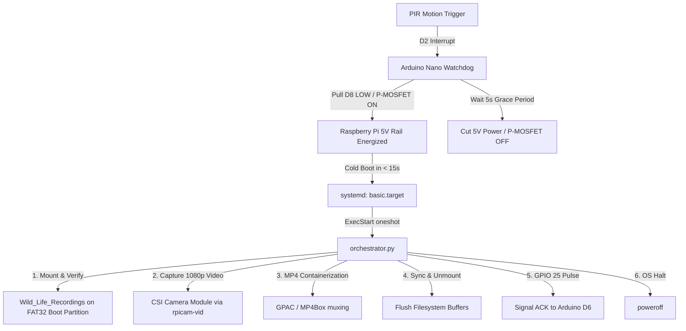

# Raspberry Pi Media Node: Service Installation & Fast-Boot Optimization Guide

This document provides both a **high-level quick setup guide** and a **detailed operational manual** for configuring a Raspberry Pi (Pi Zero W or Pi 3B) as an autonomous media recording node within the SquirrelFeeder system.

---

## 1. Quick Start: Setting Up from Scratch (End-to-End Checklist)

> [!NOTE]
> **Prerequisites:** This setup assumes your Raspberry Pi (Pi Zero W or Pi 3B) is running Raspberry Pi OS Lite, connected to your local network, and accessible via SSH (`ssh <user>@pi-zero.local`).


---

### Step 1: Enable Developer Maintenance Mode (On the Pi)
Before transferring files or installing background services, create a maintenance flag file on the Raspberry Pi. This prevents `orchestrator.py` from automatically shutting down the system after recording clips during bench development.

1. Connect to your Raspberry Pi via SSH:
   ```bash
   ssh <user>@pi-zero.local
   ```
2. Create the maintenance flag file:
   ```bash
   touch /boot/firmware/maintenance 2>/dev/null || touch /boot/maintenance
   ```
3. Keep this SSH terminal session open for subsequent steps.

---

### Step 2: Transfer the Code via `scp` (From Development Machine)
From a terminal on your **development machine** (in the repository root), transfer the `Pi_Zero` package to the Raspberry Pi:

1. Create the destination project directory on the Pi:
   ```bash
   ssh <user>@pi-zero.local "mkdir -p ~/SquirrelFeeder"
   ```

2. Copy the `Pi_Zero` folder to the Pi using `scp`:
   ```bash
   scp -r Pi_Zero <user>@pi-zero.local:~/SquirrelFeeder/
   ```

---

### Step 3: Run Setup Scripts (On the Raspberry Pi Device)

> [!IMPORTANT]
> The following commands must be executed **directly on the Raspberry Pi device** (in your SSH session on `pi-zero.local`), not on your local development computer.

1. Navigate to the project directory on the Pi:
   ```bash
   cd ~/SquirrelFeeder
   ```

2. Install system packages and utilities required by the camera pipeline:
   ```bash
   sudo apt-get update
   sudo apt-get install -y rpicam-apps ffmpeg python3 python3-pip
   ```

3. Deploy the service, set folder permissions, and register systemd units:
   ```bash
   sudo ./Pi_Zero/scripts/install.sh
   ```

4. Apply fast-boot and low-power hardware optimizations:
   ```bash
   sudo ./Pi_Zero/scripts/optimize_os.sh
   ```

---

### Step 4: Execute the Camera Integration Test & Video Pipeline

Verify camera hardware, pipeline stability, and media transfer through sequential test stages:

#### 4.1 Probe Camera Sensor (Dry Run - On the Pi)
Verify that the CSI ribbon cable is properly seated and the kernel detects the sensor module without capturing video:
```bash
# In your SSH session on the Pi:
python3 Pi_Zero/scripts/test_camera_integration.py --dry-run
```
*Expected Output:* `✓ Camera sensor detected successfully!` along with sensor model (e.g. `ov5647`) and available resolution modes.

#### 4.2 Record a Test Video (On the Pi)
Capture a 10-second test video to verify video encoding and file creation:
```bash
# In your SSH session on the Pi (use sudo for boot partition write access):
sudo python3 Pi_Zero/scripts/test_camera_integration.py --duration 10
```
*Expected Output:* `✓ CAMERA INTEGRATION TEST PASSED SUCCESSFULLY!`, saving a ~10–12 MB file to `/boot/firmware/Wild_Life_Recordings/` (or `~/Wild_Life_Recordings/`).

#### 4.3 Test Full Lifecycle Orchestrator (Dry Run - On the Pi)
Test the entire production sequence (storage check $\to$ video capture $\to$ filesystem cache sync $\to$ GPIO 25 watchdog ACK signal) while skipping system halt:
```bash
# In your SSH session on the Pi (must run with sudo for boot partition write access):
sudo python3 -m Pi_Zero.src.orchestrator --dry-run
```
*Expected Output:* `Maintenance mode or dry-run active. Skipping system poweroff.`

#### 4.4 Fetch and Verify Video Playback (On Your Development Computer)
From your local development machine terminal (in the repository root), pull the video clip and inspect playback:
```bash
python3 Pi_Zero/scripts/fetch_and_watch.py
```
*Expected Result:* The latest `.h264` or `.mp4` video is synced to your computer and automatically opens in QuickTime Player or VLC.

---

### Step 5: Prepare for Field Readiness & Remove Maintenance Flag

Once bench verification succeeds, prepare the device for autonomous deployment in the field:

#### 5.1 Remove the Maintenance Flag (On the Pi)
To allow the Pi to power off automatically after each motion capture event in the field, remove all maintenance flag files:
```bash
# In your SSH session on the Pi:
sudo rm -f /boot/firmware/maintenance
sudo rm -f /boot/maintenance
sudo rm -f ~/Wild_Life_Recordings/maintenance
sudo rm -f ~/SquirrelFeeder/Wild_Life_Recordings/maintenance
```

Verify that the flag files have been completely removed:
```bash
ls -l /boot/firmware/maintenance ~/Wild_Life_Recordings/maintenance 2>&1
```
*(Should output `No such file or directory`)*.

#### 5.2 Turn Off Wi-Fi for Field Deployment (On the Pi)
To conserve ~30–50 mA and maximize battery life in the final autonomous Squirrel Feeder device, disable the onboard Wi-Fi radio at the firmware level:
```bash
# In your SSH session on the Pi:
echo "dtoverlay=disable-wifi" | sudo tee -a /boot/firmware/config.txt 2>/dev/null || echo "dtoverlay=disable-wifi" | sudo tee -a /boot/config.txt
```
Confirm the setting was added:
```bash
grep "disable-wifi" /boot/firmware/config.txt 2>/dev/null || grep "disable-wifi" /boot/config.txt
```
*(Expected output: `dtoverlay=disable-wifi`. Wi-Fi will now remain completely powered down during cold boots)*.

#### 5.3 Physical Wiring to Arduino Watchdog Rig
Connect the Raspberry Pi header pins to the Arduino Nano hardware:
1. **Switched +5V Power:** Connect P-Channel MOSFET Drain $\to$ Raspberry Pi 5V header pins (Physical Pins 2 or 4).
2. **Common Ground:** Connect System Ground $\to$ Raspberry Pi GND header pin (Physical Pin 6).
3. **Shutdown ACK Signal:** Connect Raspberry Pi **GPIO 25** (Physical Pin 22) $\to$ Arduino Nano Pin **D6**.
4. **Pull-Down Resistor on ACK Line:** Connect a **10 kΩ resistor** between Arduino Nano Pin **D6** and **GND**. *(Critical: Without this pull-down resistor, the high-impedance ATmega328P input pin floats like an antenna, picking up EMI and spuriously triggering premature shutdown before the failsafe timeout)*.

#### 5.4 Safely Halt the Pi for Mounting
```bash
sudo poweroff
```
Once the activity LED ceases flashing, disconnect bench power and mount the Raspberry Pi into the Squirrel Feeder housing.


---

## 2. Architectural Overview

The Raspberry Pi functions as a power-cycled media capture node controlled by an external **Arduino Nano Watchdog**:



---

## 3. Complete Service Installation (Deep Dive)

### 3.1 File System & Deployment Layout

When fully installed, the project components are distributed across the system:

| Path | Purpose |
| :--- | :--- |
| `/opt/squirrelfeeder/Pi_Zero/` | Production copy of orchestrator, drivers, and scripts. |
| `/etc/systemd/system/squirrel-record.service` | Fast-boot systemd service unit. |
| `/boot/firmware/Wild_Life_Recordings/` | Video recordings directory on the FAT32 boot partition (directly accessible when plugging the SD card into macOS / Windows). |
| `/home/<user>/Wild_Life_Recordings` (or `~/Wild_Life_Recordings`) | Convenience symlink pointing to the boot partition recordings directory. |
| `/mnt/usb_storage` | Removable USB storage mountpoint (optional secondary backup). |

---

### 3.2 Prerequisites & Dependencies (On the Raspberry Pi Device)

> [!IMPORTANT]
> The packages below must be installed **directly on the Raspberry Pi device** (either via an interactive SSH terminal or an attached keyboard/monitor console on the Pi).

Open a terminal on the Raspberry Pi and run:

```bash
# 1. Update package lists
sudo apt-get update

# 2. Camera tools (standard on Raspberry Pi OS Bullseye/Bookworm)
sudo apt-get install -y rpicam-apps

# 3. MP4 muxer (ffmpeg for native QuickTime/VLC playback)
sudo apt-get install -y --no-install-recommends ffmpeg

# 4. Python 3 and core runtime utilities
sudo apt-get install -y python3 python3-pip
```

---

### 3.3 Automated Installation via `install.sh`

The installation is automated using [`/Pi_Zero/scripts/install.sh`](/Pi_Zero/scripts/install.sh).

#### Step 1: Copy / Sync the SquirrelFeeder Package to the Raspberry Pi

Before running the installer, transfer the repository files from your development machine to the Raspberry Pi.

* **Option A: Incremental Sync via `rsync` (Recommended)**  
  Run this command from the repository root on your development machine:
  ```bash
  rsync -avz --progress \
    --exclude '.venv' \
    --exclude '__pycache__' \
    --exclude '.pytest_cache' \
    Pi_Zero <user>@pi-zero.local:~/SquirrelFeeder/
  ```

* **Option B: Copy via `scp`**  
  Run this command from the repository root on your development machine:
  ```bash
  # Ensure target directory exists on the Pi
  ssh <user>@pi-zero.local "mkdir -p ~/SquirrelFeeder"

  # Copy the Pi_Zero directory
  scp -r Pi_Zero <user>@pi-zero.local:~/SquirrelFeeder/
  ```

* **Option C: Git Clone Directly on the Pi**  
  If the Raspberry Pi is connected to the internet/GitHub, clone the repository in an SSH session on the Pi:
  ```bash
  git clone <repository-url> ~/SquirrelFeeder
  ```

---

#### Step 2: Connect and Run the Installation Script

1. Connect to the Raspberry Pi via SSH:
   ```bash
   ssh <user>@pi-zero.local
   ```
2. Navigate to the project directory:
   ```bash
   cd ~/SquirrelFeeder
   ```
3. Execute the deployment script with root privileges:
   ```bash
   sudo ./Pi_Zero/scripts/install.sh
   ```

---

#### What `install.sh` Performs Step-by-Step:

1. **Deploys Codebase to `/opt/squirrelfeeder`:**  
   Copies all source modules (`orchestrator.py`, `camera_service.py`, `storage_manager.py`, `watchdog_bridge.py`) and scripts to `/opt/squirrelfeeder/Pi_Zero/`.
2. **Prepares the Recording Destination:**  
   - Detects the FAT32 boot partition mount (`/boot/firmware` on Bookworm, `/boot` on Bullseye).
   - Creates the `Wild_Life_Recordings` folder and sets open permissions (`chmod 777`).
   - Creates a symlink `/home/<user>/Wild_Life_Recordings` pointing to the partition for the active non-root user.
3. **Installs MP4 Packaging Utilities:**  
   Installs `gpac` (`MP4Box`) or `ffmpeg` so raw `.h264` camera streams are packaged into `.mp4` containers.
4. **Installs the Systemd Unit:**  
   Copies [`/Pi_Zero/scripts/squirrel-record.service`](/Pi_Zero/scripts/squirrel-record.service) to `/etc/systemd/system/squirrel-record.service` with permissions `644`.
5. **Registers and Enables the Service:**  
   Runs `systemctl daemon-reload` and `systemctl enable squirrel-record.service` so it triggers on every cold boot.

---

### 3.4 Deep Dive: Systemd Fast-Boot Unit Architecture

The systemd service unit ([`/Pi_Zero/scripts/squirrel-record.service`](/Pi_Zero/scripts/squirrel-record.service)) is configured to start as early in the boot sequence as possible:

```ini
[Unit]
Description=Squirrel Feeder Edge Camera Recording Service
DefaultDependencies=no
After=local-fs.target sysinit.target systemd-modules-load.service
Before=shutdown.target

[Service]
Type=oneshot
User=root
WorkingDirectory=/opt/squirrelfeeder
Environment="PYTHONPATH=/opt/squirrelfeeder"
ExecStart=/usr/bin/python3 -m Pi_Zero.src.orchestrator
StandardOutput=journal+console
StandardError=journal+console
TimeoutSec=45

[Install]
WantedBy=basic.target
```

#### Key Architecture Decisions:
* **`DefaultDependencies=no`:** Standard systemd services wait for networking, logging, time synchronization, and multi-user targets. Setting this to `no` strips away dozens of blocking dependencies.
* **`WantedBy=basic.target`:** The service begins execution as soon as basic kernel modules and filesystems are mounted (~8–10 seconds into boot), rather than waiting 30+ seconds for `multi-user.target` or `network-online.target`.
* **`TimeoutSec=45`:** Acts as a software watchdog. If camera capture stalls, systemd aborts the job to ensure the OS powers off before the Arduino's 60-second hardware timer cuts power.

---

## 4. Fast-Boot & Low-Power Optimization (Deep Dive)

Standard Raspberry Pi OS Lite boots in **35 to 50 seconds** and consumes ~150–220 mA idle.  
Our field target is **< 15 seconds cold-boot** and minimal energy consumption.

### 4.1 Automated Optimization (`optimize_os.sh` & `optimize_pi3.sh`)

The optimization script auto-detects whether the board is a **Raspberry Pi Zero / Zero W** or a **Raspberry Pi 3 (3B / 3B+)**, or accepts explicit profile flags:

```bash
# Auto-detect connected board model (Zero or Pi 3B):
sudo ./Pi_Zero/scripts/optimize_os.sh

# Or target specifically for Raspberry Pi 3 (3B / 3B+):
sudo ./Pi_Zero/scripts/optimize_pi3.sh
# (or sudo ./Pi_Zero/scripts/optimize_os.sh --pi3)

# Or target specifically for Raspberry Pi Zero / Zero W:
sudo ./Pi_Zero/scripts/optimize_os.sh --zero
```

---

### 4.2 Detailed Optimization Breakdown

#### 1. Hardware Firmware Tuning (`/boot/firmware/config.txt`)

Add or verify the following configuration flags in `/boot/firmware/config.txt` (or `/boot/config.txt`):

```ini
# ==============================================================================
# SQUIRREL FEEDER FAST-BOOT & POWER OPTIMIZATIONS
# ==============================================================================

# Force ARM CPU to maximum frequency during kernel boot (saves 3-5 seconds)
initial_turbo=30

# Remove artificial bootloader delays
boot_delay=0

# Disable rainbow splash screen (saves framebuffer init time)
disable_splash=1

# Disable Bluetooth controller entirely (saves ~15-20 mA)
dtoverlay=disable-bt

# Disable Wi-Fi controller in field deployment (saves ~30-50 mA)
# NOTE: Leave commented out during development/SSH testing!
# dtoverlay=disable-wifi

# Power off HDMI circuitry at the hardware level (saves ~25-30 mA)
# NOTE: If using an external HDMI monitor for debugging, comment this out!
hdmi_blanking=2
```

> [!WARNING]
> If you are connecting an HDMI monitor to a Raspberry Pi 3B or Zero for console debugging and the screen is black, ensure `hdmi_blanking=2` is commented out.

---

#### 2. Kernel Command Line (`/boot/firmware/cmdline.txt`)

Open `/boot/firmware/cmdline.txt` and append the following kernel flags to the single existing line (do not add line breaks):

```text
console=serial0,115200 console=tty1 root=PARTUUID=... rootfstype=ext4 fsck.repair=yes rootwait quiet loglevel=3
```

* **`quiet loglevel=3`:** Suppresses verbose kernel dmesg messages to console output, saving CPU cycles and serial transmission delays.
* **`fsck.repair=yes`:** Automatically resolves minor FAT filesystem dirty bits without halting interactive prompts.

---

#### 3. Masking Non-Essential Systemd Daemons

Disable and mask background daemons that are unnecessary on a headless camera node:

```bash
# Bluetooth services
sudo systemctl mask bluetooth.service hciuart.service

# Printing services
sudo systemctl mask cups.service cups-browsed.service

# Daily update and indexing jobs
sudo systemctl mask apt-daily.service apt-daily.timer
sudo systemctl mask apt-daily-upgrade.service apt-daily-upgrade.timer
sudo systemctl mask man-db.service man-db.timer

# Unneeded hardware handlers
sudo systemctl mask triggerhappy.service ModemManager.service

# Headless boot speedups (saves ~9 seconds combined)
sudo systemctl mask keyboard-setup.service
sudo touch /etc/cloud/cloud-init.disabled
sudo systemctl mask cloud-init.service cloud-init-main.service cloud-init-local.service cloud-init-network.service
```

> [!NOTE]
> **Do not mask `avahi-daemon.service`** if you rely on mDNS host resolution (`pi-zero.local`) or USB Ethernet Gadget SSH connections during bench testing.

---

#### 4. Runtime Display Off (`/etc/rc.local`)

On older VideoCore firmware releases, shut down the HDMI video generator:

```bash
/usr/bin/tvservice -o 2>/dev/null || true
```

---

## 5. Maintenance Mode vs. Field Deployment Profiles

Because `orchestrator.py` initiates a system `poweroff` after recording, working interactively over SSH or connecting a display requires **Bench / Developer Mode**. When ready for battery operation, switch to **Autonomous Field Mode**.

Use [`maintenance.sh`](/Pi_Zero/scripts/maintenance.sh) to switch profiles seamlessly:

### 5.1 Switching Profiles

#### Bench / Developer Mode (Pi Stays Awake, Wi-Fi & HDMI ON)
When the microSD card is inserted into your Mac (or in an active SSH session):
```bash
./Pi_Zero/scripts/maintenance.sh bench
# (aliases: ./maintenance.sh on, ./maintenance.sh dev)
```
* **Auto-Shutdown:** DISABLED (`maintenance` and `no_shutdown` flags created).
* **Wi-Fi:** ENABLED (`dtoverlay=disable-wifi` commented out in `config.txt`).
* **HDMI:** ENABLED (`hdmi_blanking=2` commented out in `config.txt`).

#### Field Deployment Mode (Auto-Shutdown ON, Wi-Fi & HDMI OFF)
When ready to install the feeder in the yard:
```bash
./Pi_Zero/scripts/maintenance.sh field
# (aliases: ./maintenance.sh off, ./maintenance.sh deploy)
```
* **Auto-Shutdown:** ENABLED (flags removed; Pi halts cleanly after 20s recording).
* **Wi-Fi:** DISABLED (`dtoverlay=disable-wifi` added to save ~30–50 mA).
* **HDMI:** DISABLED (`hdmi_blanking=2` added to save ~25–30 mA).
* *(Optional)* If you want auto-shutdown enabled but wish to keep Wi-Fi active for testing, add `--keep-wifi`:
  ```bash
  ./Pi_Zero/scripts/maintenance.sh field --keep-wifi
  ```

### 5.2 Accessing the Pi When Wi-Fi is Disabled

If Wi-Fi and HDMI are turned off in field mode, you have three ways to access the Pi again:

1. **Direct MicroSD on Mac (Recommended):**
   Power down the Pi, plug the microSD card into your Mac, and run:
   ```bash
   ./Pi_Zero/scripts/maintenance.sh bench
   ```
   This modifies `/Volumes/bootfs/config.txt` and re-enables Wi-Fi and HDMI with zero network required.
2. **Wired Ethernet (Raspberry Pi 3):**
   Connect an Ethernet cable from the Pi 3 to your router or laptop. SSH over Ethernet (`ssh david@pi-3.local`) works even when Wi-Fi is disabled.
3. **Serial Console:**
   Connect a 3.3V USB-to-UART bridge to GPIO 14 (TX) / GPIO 15 (RX).

---

## 6. Testing & Diagnostic Workflows

### 6.1 Standalone Camera Hardware Test

Verify camera ribbon alignment, sensor communication, and recording without triggering the full orchestrator:

```bash
# 1. Hardware probe only (checks sensor detection without recording)
python3 Pi_Zero/scripts/test_camera_integration.py --dry-run

# 2. Capture a 10-second test video (use sudo for boot partition write access)
sudo python3 Pi_Zero/scripts/test_camera_integration.py --duration 10
```

---

### 6.2 Dry-Run Orchestrator Execution

Test the full lifecycle (storage mount -> recording -> unmount -> GPIO ACK) while skipping `poweroff`:

```bash
sudo python3 -m Pi_Zero.src.orchestrator --dry-run
```

---

### 6.3 Analyzing Boot Performance

To inspect systemd startup duration and locate bottleneck services:

```bash
# View overall kernel and userspace boot duration
systemd-analyze

# List services by startup time consumed (descending)
systemd-analyze blame

# View the critical execution path to basic.target
systemd-analyze critical-chain squirrel-record.service
```

---

### 6.4 Inspecting Service Logs

```bash
# View logs from current boot
journalctl -u squirrel-record.service -b

# Follow live output
journalctl -u squirrel-record.service -f
```

---

### 6.5 Fetching Recordings to a Development Machine

From your development machine terminal in the repository root:

```bash
# Automatic sync and video launch
python3 Pi_Zero/scripts/fetch_and_watch.py

# Or fetch from a custom remote folder
python3 Pi_Zero/scripts/fetch_and_watch.py --remote-dir SquirrelFeeder/Wild_Life_Recordings
```
